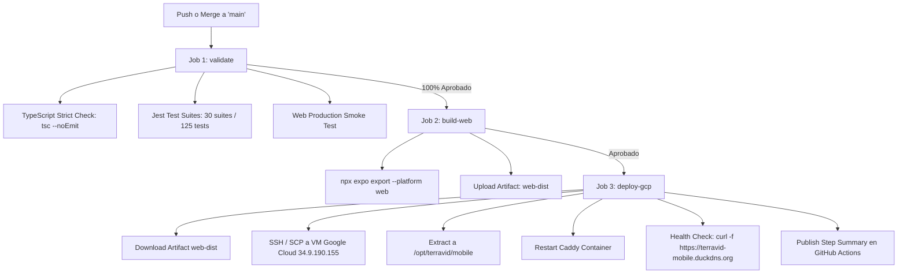

# 🚀 Plan Completo de Despliegue — TerraVid Mobile (Android, iOS y Web)

Este documento detalla la arquitectura, prerrequisitos, comandos y procesos paso a paso para compilar, firmar, distribuir y publicar la aplicación **TerraVid Mobile** en sus tres plataformas de destino: **Android**, **iOS** y **Web**.

---

## 1. Estrategia de Ambientes y Variables

| Ambiente | Propósito | Backend URL | Distribución |
|---|---|---|---|
| **Development** | Desarrollo local y emuladores | `http://<IP-LOCAL>:3000/api` | Expo Go / Expo Dev Client |
| **Preview (Staging)** | Pruebas de campo con capataces | `https://staging-api.terravid.com/api` | **Android**: APK directo<br>**iOS**: TestFlight Interno<br>**Web**: Vercel / Netlify Staging |
| **Production** | Operación real de cosecha y labores | `https://api.terravid.com/api` | **Android**: Google Play Store (AAB)<br>**iOS**: Apple App Store (IPA)<br>**Web**: Nginx / CDN CloudFront |

### Configuración de Variables de Entorno
Crea los archivos de entorno correspondientes o configúralos en **EAS Secrets**:
- `.env.development`: `EXPO_PUBLIC_API_BASE_URL=http://192.168.1.100:3000/api`
- `.env.staging`: `EXPO_PUBLIC_API_BASE_URL=https://staging-api.terravid.com/api`
- `.env.production`: `EXPO_PUBLIC_API_BASE_URL=https://api.terravid.com/api`

---

## 2. Prerrequisitos Globales

1. **Instalar EAS CLI globalmente**:
   ```bash
   npm install -g eas-cli
   ```
2. **Iniciar sesión en Expo**:
   ```bash
   eas login
   ```
3. **Vincular el proyecto a EAS**:
   ```bash
   eas project:init
   ```
   *(Esto generará el `projectId` en `app.json`).*

---

## 3. Despliegue en Android

### 3.1. Prerrequisitos
- **Google Play Developer Account** (pago único de $25 USD en [play.google.com/console](https://play.google.com/console)).
- Archivo `google-services.json` (descargado de Firebase Console para Push Notifications FCM).

---

### 3.2. Ambiente Preview (APK para pruebas directas en viñedo)
Permite generar un archivo `.apk` instalable directamente en cualquier celular Android sin pasar por Google Play Store:

```bash
# Compilar APK de preview en la nube de EAS
eas build --platform android --profile preview
```
* **Resultado**: Al finalizar, la terminal te dará un enlace y un código QR para descargar el `.apk` directamente en los celulares de los capataces.

---

### 3.3. Ambiente Producción (Google Play Store)

#### Paso 1: Generar el Android App Bundle (.aab)
```bash
eas build --platform android --profile production
```
*EAS gestionará automáticamente la clave criptográfica de firma (Keystore) de forma segura en la nube.*

#### Paso 2: Subir a Google Play Console (Track Interno / Producción)
1. **Configurar Google Service Account**:
   - En Google Cloud Console, crea una cuenta de servicio con permisos en Google Play Android Developer.
   - Descarga la clave en formato JSON (ej. `pc-api-key.json`).
2. **Enviar el binario automáticamente**:
   ```bash
   eas submit --platform android --profile production --key pc-api-key.json
   ```
3. **Completar ficha en Google Play Console**:
   - Capturas de pantalla para teléfonos y tablets.
   - Declaración de políticas de privacidad y permisos (`INTERNET`, `VIBRATE`).
   - Promover de *Pruebas Internas* $\to$ *Producción*.

---

## 4. Despliegue en iOS

### 4.1. Prerrequisitos
- **Apple Developer Program** ($99 USD/año en [developer.apple.com](https://developer.apple.com)).
- Acceso a **App Store Connect**.

---

### 4.2. Ambiente Preview / TestFlight
Apple no permite instalar archivos sueltos sin firmar. La forma oficial y más rápida es a través de **TestFlight**:

```bash
# Compilar binario para TestFlight
eas build --platform ios --profile preview
```
*EAS solicitará tus credenciales de Apple Developer una única vez para generar el Certificado de Distribución y el Provisioning Profile automáticamente.*

---

### 4.3. Ambiente Producción (Apple App Store)

#### Paso 1: Compilar para Producción
```bash
eas build --platform ios --profile production
```

#### Paso 2: Enviar a App Store Connect
```bash
eas submit --platform ios --profile production
```

#### Paso 3: Ficha en App Store Connect
- Subir capturas de pantalla de iPhone (6.7" y 6.5").
- Completar descripción, URL de soporte y política de privacidad.
- Enviar a Revisión de Apple (*App Review*).

---

## 5. Despliegue en Web

La versión Web de TerraVid Mobile permite a supervisores y administrativos acceder a la misma interfaz desde cualquier navegador de escritorio o tablet.

### 5.1. Compilación del Bundle Estático
Para generar los archivos estáticos optimizados (HTML, JS, CSS, Assets):

```bash
npx expo export --platform web
```
*Esto generará la carpeta **`dist/`** lista para ser servida.*

---

### 5.2. Opciones de Hosting para Producción

#### Opción A: Despliegue en Google Cloud VM + Caddy (Producción Actual — 100% Operativo)

La aplicación Web de producción se encuentra alojada en la máquina virtual de Google Cloud (`terravid`), servida por **Caddy 2 con HTTPS automático y compresión Zstandard / Gzip**:

- **URL de Producción**: [`https://terravid-mobile.duckdns.org`](https://terravid-mobile.duckdns.org)
- **Directorio en VM**: `/opt/terravid/mobile/`
- **Configuración de Caddy** (`/opt/backend/deploy/Caddyfile`):
  ```caddy
  terravid-mobile.duckdns.org {
      root * /srv/mobile
      file_server
      try_files {path} /index.html
      encode zstd gzip

      header {
          Strict-Transport-Security "max-age=31536000; includeSubDomains"
          X-Content-Type-Options "nosniff"
          X-Frame-Options "SAMEORIGIN"
          Referrer-Policy "no-referrer"
          -Server
      }
  }
  ```

---

## 6. Pipeline de Entrega Continua (CD) Automatizado (GitHub Actions)

El workflow [`.github/workflows/deploy-mobile.yml`](file:///c:/Users/SergioFarias/Downloads/UTN%20FRM/TerraVid/Mobile/.github/workflows/deploy-mobile.yml) implementa un pipeline de **3 etapas** que compila, valida y publica automáticamente a la VM de Google Cloud en cada `push` o `merge` a la rama `main`:



### Configuración de GitHub Secrets

Para habilitar el despliegue automático por SSH, se configuran los siguientes **Secrets** en el repositorio (`Settings -> Secrets and variables -> Actions`):

| Secret | Descripción | Valor |
|---|---|---|
| `GCP_VM_HOST` | IP o dominio de la VM | `34.9.190.155` o `terravid-mobile.duckdns.org` |
| `GCP_VM_USER` | Usuario SSH en la VM | `SergioFarias` |
| `GCP_VM_SSH_KEY` | Clave privada SSH (ED25519) | Contenido de `id_ed25519_deploy` |
| `EXPO_PUBLIC_API_BASE_URL` | Endpoint base de la API REST | `https://terravid-api.duckdns.org/api` |

---

---

## 8. Checklist Pre-Lanzamiento (Go-Live)

- [ ] **Backend URL**: Verificar que `EXPO_PUBLIC_API_BASE_URL` apunte al dominio HTTPS de producción.
- [ ] **CORS**: En el backend (`Platform/src/main.ts`), confirmar que el dominio Web de producción esté en `allowedOrigins`.
- [ ] **Iconos y Splash**: Assets de alta resolución ubicados en `assets/`.
- [ ] **Versionado**: Incrementar `version` (ej. `1.0.1`) y `versionCode` / `buildNumber` en `app.json`.
- [ ] **Credenciales EAS**: Ejecutar `eas credentials` para validar certificados activos de Android e iOS.
- [ ] **Batería de Pruebas Offline**: Realizar una prueba física de carga de labor y pesaje en modo avión y verificar auto-sincronización al reactivar la conexión.
