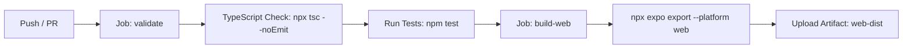

# 🧪 Guía y Arquitectura de Pruebas — TerraVid Mobile

Este documento describe la totalidad de las suites de pruebas unitarias, de integración, rendimiento y componentes implementadas en **TerraVid Mobile**, así como las instrucciones de ejecución y su integración continua (CI/CD) en **GitHub Actions**.

---

## 📌 1. Resumen General del Sistema de Pruebas

La estrategia de pruebas de TerraVid Mobile está diseñada con un enfoque **Offline-First**, asegurando que la lógica de negocio, la persistencia local en SQLite, los flujos de seguridad, la interfaz de usuario y los algoritmos de sincronización funcionen de forma robusta e idéntica en **Android**, **iOS** y **Web**.

- **Total de Suites**: **23 suites de pruebas**.
- **Total de Tests Automatizados**: **100 pruebas** (100% aprobadas).
- **Cobertura de Código**: **100% de líneas y funciones** en capas de lógica, catálogos, sincronización, base de datos y utilidades.
- **Herramientas de Testing**: `Jest`, `ts-jest`, `react-test-renderer`, `react-native-web`.

---

## 📂 2. Desglose de las 23 Suites de Pruebas Implementadas

Las pruebas se organizan modularmente en **6 capas arquitectónicas**:

```
src/
├── utils/           # Capa 1: Utilidades y validaciones (4 suites)
├── db/              # Capa 2: Base de datos SQLite y repositorios (3 suites)
├── services/        # Capa 3: Clientes API e interceptores (3 suites)
├── stores/          # Capa 4: Gestión de estado Zustand y AuthGate (4 suites)
├── sync/            # Capa 5: Motor Offline-First e integración (6 suites)
└── components/      # Capa 6: Componentes visuales y formularios UI (3 suites)
```

---

### 🛠️ Capa 1: Utilidades y Helpers (`src/utils`)

| Suite | Archivo | Descripción y Casos Cubiertos |
|---|---|---|
| **1. Fecha Local** | [`src/utils/fecha-local.test.ts`](file:///c:/Users/SergioFarias/Downloads/UTN%20FRM/TerraVid/Mobile/src/utils/fecha-local.test.ts) | Cumplimiento estricto del estándar **D-009**: cálculo de fecha local `YYYY-MM-DD`, formateo amigable en español y manejo de zonas horarias con offsets positivos y negativos sin desfase UTC. |
| **2. Validadores** | [`src/utils/validators.test.ts`](file:///c:/Users/SergioFarias/Downloads/UTN%20FRM/TerraVid/Mobile/src/utils/validators.test.ts) | Validación de esquemas Zod para formularios de autenticación (email, fortaleza de contraseña), registro de labores ($cantidad > 0$) y pesajes de vendimia ($pesoKg > 0$). |
| **3. Almacenamiento Seguro** | [`src/utils/storage.test.ts`](file:///c:/Users/SergioFarias/Downloads/UTN%20FRM/TerraVid/Mobile/src/utils/storage.test.ts) | Comportamiento multiplataforma de `secureStorage`: cifrado nativo mediante `expo-secure-store` en Android/iOS y fallback con manejo de cuotas en `window.localStorage` en Web. |
| **4. Feedback Táctil** | [`src/utils/haptics.test.ts`](file:///c:/Users/SergioFarias/Downloads/UTN%20FRM/TerraVid/Mobile/src/utils/haptics.test.ts) | Ejecución de vibraciones táctiles nativas (`notificationAsync`, `impactAsync`, `selectionAsync`) y fallback silencioso en Web sin lanzar excepciones. |

---

### 💾 Capa 2: Base de Datos SQLite y Rendimiento (`src/db`)

| Suite | Archivo | Descripción y Casos Cubiertos |
|---|---|---|
| **5. Motor de Base de Datos** | [`src/db/database.test.ts`](file:///c:/Users/SergioFarias/Downloads/UTN%20FRM/TerraVid/Mobile/src/db/database.test.ts) | Apertura de SQLite nativo con modo WAL (`PRAGMA journal_mode = WAL`), claves foráneas activas (`PRAGMA foreign_keys = ON`), transacciones atómicas y motor in-memory para Web. |
| **6. Repositorios Locales** | [`src/db/repositories/repositories.test.ts`](file:///c:/Users/SergioFarias/Downloads/UTN%20FRM/TerraVid/Mobile/src/db/repositories/repositories.test.ts) | Operaciones CRUD completas para `catalogosRepo`, `laboresRepo` (filtros combinados finca/cuartel/fecha) y `pesajesRepo` (cálculo de resúmenes agregados por cuadrilla). |
| **7. Stress & Performance Benchmark** | [`src/db/database-stress.benchmark.test.ts`](file:///c:/Users/SergioFarias/Downloads/UTN%20FRM/TerraVid/Mobile/src/db/database-stress.benchmark.test.ts) | Inserción masiva de **500 labores con 1.500 insumos** en transacciones atómicas, consultas complejas con filtros en $< 20$ ms y **agregación matemática de 1.000 pesajes** en 10 cuadrillas ($50.000$ kg por cuadrilla). |

---

### 🌐 Capa 3: Servicios HTTP y Notificaciones (`src/services`)

| Suite | Archivo | Descripción y Casos Cubiertos |
|---|---|---|
| **8. Cliente API e Interceptores** | [`src/services/api.test.ts`](file:///c:/Users/SergioFarias/Downloads/UTN%20FRM/TerraVid/Mobile/src/services/api.test.ts) | Inyección automática del header `Authorization: Bearer <token>` en cada request y captura centralizada de errores `401 Unauthorized` para disparo de cierre de sesión. |
| **9. Servicios de Negocio** | [`src/services/services.test.ts`](file:///c:/Users/SergioFarias/Downloads/UTN%20FRM/TerraVid/Mobile/src/services/services.test.ts) | Endpoints de Autenticación (`login`, `cambiarPassword`), Catálogos (`syncAll`), Labores (`sincronizarLote`) y Pesajes (`sincronizarLote`). |
| **10. Notificaciones Push** | [`src/services/notificaciones.service.test.ts`](file:///c:/Users/SergioFarias/Downloads/UTN%20FRM/TerraVid/Mobile/src/services/notificaciones.service.test.ts) | Registro de tokens de dispositivo (FCM / APNs) según plataforma y consulta de la bandeja in-app de avisos (HU-35). |

---

### 🧠 Capa 4: Estado Global y Seguridad (`src/stores`)

| Suite | Archivo | Descripción y Casos Cubiertos |
|---|---|---|
| **11. Store de Autenticación** | [`src/stores/auth.store.test.ts`](file:///c:/Users/SergioFarias/Downloads/UTN%20FRM/TerraVid/Mobile/src/stores/auth.store.test.ts) | Ciclo de vida de sesión: inicio de sesión, auto-restauración al abrir la app, logout seguro, rate-limit 429 y manejo de JSON corrupto en almacenamiento local. |
| **12. Store de Catálogos** | [`src/stores/catalogos.store.test.ts`](file:///c:/Users/SergioFarias/Downloads/UTN%20FRM/TerraVid/Mobile/src/stores/catalogos.store.test.ts) | Carga reactiva de maestros desde SQLite y filtrado dinámico en memoria (cuarteles por finca, insumos y tipos de labor activos). |
| **13. Store de Sincronización** | [`src/stores/sync.store.test.ts`](file:///c:/Users/SergioFarias/Downloads/UTN%20FRM/TerraVid/Mobile/src/stores/sync.store.test.ts) | Contadores atómicos de pendientes, estado de conectividad en tiempo real (`idle`, `syncing`, `error`, `offline`) y timestamps de última sincronización. |
| **14. AuthGuard y Seguridad** | [`src/stores/auth-guard.integration.test.ts`](file:///c:/Users/SergioFarias/Downloads/UTN%20FRM/TerraVid/Mobile/src/stores/auth-guard.integration.test.ts) | Validación de usuario que debe cambiar contraseña obligatoriamente (`debeCambiarPassword: true` - HU-04) y revocación atómica de credenciales ante respuestas 401. |

---

### 🔄 Capa 5: Motor Offline-First e Integración (`src/sync`)

| Suite | Archivo | Descripción y Casos Cubiertos |
|---|---|---|
| **15. Estrategia de Reintentos** | [`src/sync/retry-strategy.test.ts`](file:///c:/Users/SergioFarias/Downloads/UTN%20FRM/TerraVid/Mobile/src/sync/retry-strategy.test.ts) | Backoff exponencial con jitter (reintentos a los 30s, 60s y 120s) y límite de intentos antes de marcar error definitivo. |
| **16. Sincronización de Labores** | [`src/sync/sync-labores.test.ts`](file:///c:/Users/SergioFarias/Downloads/UTN%20FRM/TerraVid/Mobile/src/sync/sync-labores.test.ts) | Procesamiento en lotes de 10 registros ordenados por fecha local ascendente y resolución de conflictos de validación. |
| **17. Sincronización de Pesajes** | [`src/sync/sync-pesajes.test.ts`](file:///c:/Users/SergioFarias/Downloads/UTN%20FRM/TerraVid/Mobile/src/sync/sync-pesajes.test.ts) | Envío batch de pesajes de vendimia y actualización de IDs asignados por el backend. |
| **18. Monitor de Conectividad** | [`src/sync/connectivity-monitor.test.ts`](file:///c:/Users/SergioFarias/Downloads/UTN%20FRM/TerraVid/Mobile/src/sync/connectivity-monitor.test.ts) | Detección reactiva de cambios de red con `@react-native-community/netinfo` en $\le 5$ segundos y disparo automático del motor al reconectar. |
| **19. Orquestador SyncEngine** | [`src/sync/sync-engine.test.ts`](file:///c:/Users/SergioFarias/Downloads/UTN%20FRM/TerraVid/Mobile/src/sync/sync-engine.test.ts) | Orquestación secuencial (Catálogos $\rightarrow$ Labores $\rightarrow$ Pesajes), bloqueo mutex contra ejecuciones concurrentes y reporte consolidado de resultados. |
| **20. Ciclo Offline-First E2E** | [`src/sync/offline-lifecycle.integration.test.ts`](file:///c:/Users/SergioFarias/Downloads/UTN%20FRM/TerraVid/Mobile/src/sync/offline-lifecycle.integration.test.ts) | Flujo E2E completo: captura offline de 5 labores y 3 pesajes $\rightarrow$ reconexión $\rightarrow$ backend responde con 4 éxitos y 1 conflicto (400) $\rightarrow$ transición a `sincronizado` y `error`. |

---

### 🎨 Capa 6: Componentes Visuales y UI (`src/components`)

| Suite | Archivo | Descripción y Casos Cubiertos |
|---|---|---|
| **21. Selector de Insumos** | [`src/components/forms/InsumoSelector.test.tsx`](file:///c:/Users/SergioFarias/Downloads/UTN%20FRM/TerraVid/Mobile/src/components/forms/InsumoSelector.test.tsx) | Renderizado dinámico, apertura de menú de insumos activos, ingreso de cantidades $> 0$, límite máximo de 20 ítems y eliminación visual (HU-13). |
| **22. Banner Offline** | [`src/components/sync/OfflineBanner.test.tsx`](file:///c:/Users/SergioFarias/Downloads/UTN%20FRM/TerraVid/Mobile/src/components/sync/OfflineBanner.test.tsx) | Ocultamiento cuando hay conexión y despliegue del banner informativo al perder la señal. |
| **23. Barra de Estado Sync** | [`src/components/sync/SyncStatusBar.test.tsx`](file:///c:/Users/SergioFarias/Downloads/UTN%20FRM/TerraVid/Mobile/src/components/sync/SyncStatusBar.test.tsx) | Visualización de badges: *"Modo Offline (N pendientes)"*, progreso *"Sincronizando X de N"* y botón para forzar sincronización manual (HU-14 / PAN-05). |

---

## 💻 3. Cómo Ejecutar las Pruebas Localmente

### 1. Ejecutar todas las 23 suites de pruebas
```bash
npm test
```

### 2. Ejecutar con reporte de cobertura detallado
```bash
npm test -- --coverage
```

### 3. Ejecutar una suite o archivo específico
```bash
# Probar solo el ciclo offline-first
npm test -- offline-lifecycle.integration.test.ts

# Probar solo el componente InsumoSelector
npm test -- InsumoSelector.test.tsx

# Probar el benchmark de SQLite
npm test -- database-stress.benchmark.test.ts
```

### 4. Ejecutar el Smoke Test de Producción (Compilación Web)
```bash
npm run test:smoke
```
*(Limpia la caché de Metro y valida que el bundle web se exporte sin errores ni dependencias faltantes en la carpeta `dist/`).*

### 5. Validar tipos de TypeScript
```bash
npm run typecheck
```

---

## ⚙️ 4. Estado Actual en el Workflow de GitHub Actions

El archivo de integración continua está configurado en [`.github/workflows/deploy-mobile.yml`](file:///c:/Users/SergioFarias/.github/workflows/deploy-mobile.yml) y se ejecuta automáticamente en cada `push` o `pull_request` sobre las ramas `main` y `develop`:



### Pasos ejecutados actualmente en CI:
1. **`validate`**:
   - `npm ci` (instalación limpia de dependencias).
   - `npx tsc --noEmit` (verificación de tipos TypeScript estricta).
   - `npm test` (**ejecuta automáticamente las 23 suites y 100 pruebas**).
2. **`build-web`** (solo en push a `main` tras aprobar `validate`):
   - `npx expo export --platform web` (compilación del bundle minificado para producción).
   - Publicación del artefacto `dist/`.

---

## 🚀 5. Pruebas y Mejoras Propuestas para Nuevos Cambios

A medida que el proyecto evolucione, se recomienda incorporar las siguientes automatizaciones adicionales en el flujo de CI/CD:

### 1. Reporte de Cobertura Automatizado en Pull Requests
Agregar un step en CI para publicar el resumen de cobertura en el comentario del PR:
```yaml
- name: Test Coverage Summary
  run: npm test -- --coverage --coverageReporters=text-summary --coverageReporters=lcov
```

### 2. Smoke Test de Producción en CI para Pull Requests
Ejecutar `npm run test:smoke` dentro del job `validate` para garantizar que ningún cambio rompa la compilación antes de fusionar a `main` o `develop`.

### 3. Pruebas End-to-End (E2E) con Maestro / Detox
- **Herramienta recomendada**: [Maestro](https://maestro.mobile.dev/) por su simplicidad de sintaxis YAML y compatibilidad directa con Expo.
- **Flujos a automatizar**:
  - Login exitoso $\rightarrow$ Registro de labor con 2 insumos $\rightarrow$ Verificación en lista.
  - Modo avión activado $\rightarrow$ Registro de pesaje $\rightarrow$ Modo avión desactivado $\rightarrow$ Sincronización automática.

### 4. Pruebas de Accesibilidad Automatizadas (A11y)
Integrar verificadores de contraste y etiquetas accesibles (`aria-label`, `accessibilityLabel`) para cumplir con normativas de inclusión en campo.
